# Project status

**Read this first.** The current state of the project, rewritten in place. For history and the reasons behind decisions, see [RESEARCH_LOG.md](RESEARCH_LOG.md). Both files were rebuilt by a full audit on 2026-11-22 ([docs/_audit_report.md](docs/_audit_report.md)). Statements carry their evidence (path, commit or command); anything without evidence is marked UNVERIFIED.

## Summary

AgentSOC 2.0 (the system is called **GuardedSOC** in the newest paper) is a KMIT (Hyderabad) student research project: 5 students and a mentor, with engineering led by Abhishek. It is a research prototype of an LLM-driven Security Operations Centre (SOC) that defends its own two attack surfaces:
- the LLM reads log text an attacker can write (indirect prompt injection, "log contamination");
- the memory (a Knowledge Store that learns what is normal) can be taught the attacker ("memory poisoning").

It builds on the AgentSOC paper (Roy and Singh, IEEE ICAIC 2026, arXiv:2604.20134). It is evaluated on a contamination corpus built from Microsoft GUIDE and on DEDALE (Inria, labelled testbed telemetry). It also runs as a live demo tool with a React web console. It exists to produce one research paper and a working tool someone outside the team can run (`PROJECT_PLAN.md` §1).

**Status (audited 2026-11-22; tests, journal and next steps updated 2026-11-24):**
- Pipeline and tool are finished. The GUIDE and DEDALE results were frozen on 2026-10-31. Tests pass (825 passed, 1 deselected; 2026-11-24, branch `paper-revision-design`).
- Re-checked on this machine: the three GUIDE acting-rule re-scores are byte-identical to the committed ones. The full offline DEDALE re-freeze (43 replays) reproduced every frozen score file byte-identically (see "Reproduce" below).
- The paper to submit is the journal version in `paper/tandf/` (since 2026-11-24; generated from `paper/agentsoc_v3.tex`; git-ignored, backup in `D:\agentsoc_data\paper_private\`). The Word file `AgentSOC_IEEE_Revised.docx` is no longer the submission file.
- Left for the team: submit the journal version once the running experiments are in it, record the demo video, hand in the SDC-II course report (`GuardedSOC_SDC2_Report.docx`, git-ignored; new Fig. 1 since 2026-11-24), and (optional) a third dataset.

## Terms used in this file

| Term | Meaning |
|:--|:--|
| SOC | Security Operations Centre: analysts triaging security alerts |
| NCE | Narrative Counterfactual Engine: the LLM step. It proposes MITRE ATT&CK hypotheses (technique, account, source and target host) from an alert's evidence text (`perception/nce_engine.py`) |
| SSE | Structural Simulation Engine: checks each hypothesis against the environment graph (FEASIBLE / CONDITIONALLY_FEASIBLE / INFEASIBLE) (`perception/sse.py`) |
| Entity binding | Flags hypothesis entities that the alert's trusted fields do not contain ("unbound": possible steering) (`perception/entity_binding.py`) |
| RSEM | Risk Scoring and Evaluation Module: ranks responses by α·containment − β·business impact (`perception/rsem.py`) |
| Guardrails | Hard floors on actions and playbook status (auto-approved / pending analyst review) (`perception/action_playbook.py`) |
| ERA | Evidence Risk Assessment: regex, embedding-similarity, approval-claim and split-field detectors that score text for injection. It only escalates, and runs on GUIDE only (`risk_assessment/`) |
| KS | Knowledge Store: the SQLite-backed graph the loop learns into (`perception/knowledge_db.py`) |
| Learning gate | Learns a test-period case only if it was dismissed, 24 h after closing, and nothing on the same host escalated meanwhile (`perception/knowledge_updater.py`) |
| Triage gate | Per new case: escalations, then the learned pattern, then the decision cache, then the pipeline with NCE behind a daily budget (`perception/triage_gate.py`) |
| Asymmetric trust | Decision P9 A (2026-10-31): the LLM's output may raise scrutiny, never lower it (`--llm-authority escalate`). The older rule, where NCE output can dismiss or justify an action, is `full` ("acting rule"). **Defaults:** the demo server uses `escalate` (`soc_server/__main__.py:84`). The replays, `rescore_v2` and `TriageGate` default to `full` (`perception/triage_gate.py:102`). **Which rule gives which paper number** (numbering of `paper/agentsoc_combined.tex`): Tables I, II, IV, V, Figs. 2-3 and C4's 54.8 / 33.2 use `full`; C6 / Table III compares both (`README.md`, "Which rule produces which result"). Without NCE both rules decide the same |
| P9 A-D | Decision P9 parts: A asymmetric trust (done). B the precursor attack on the learning gate (an attacker first gets harmless-looking activity learned so later steps match it) and corroborated learning, not started. C attacker text aimed at the analyst, where verdicts on text-flagged cases cannot teach the store without a second analyst; not started. D prompt-level baselines, which need a call budget (a pilot on 2026-11-01 got only HTTP 503) |
| P8 review changes | Ten fixes from an external review, in the order planned (`PROJECT_PLAN.md` P8): 5 decision-cache policy versions (done), 8 safe checkpoint loading (done), 9 hash-chained audit logs (never built), 3 observed / feasible / confirmed in the case view (dropped), 2 ERA hardening, 6 second approval for `benign` verdicts on critical hosts, 7 unlearning that follows a pattern's decisions, 4 stricter learning (2, 4, 6, 7 folded into P9 B and C, not started), 10 hypotheses citing evidence (dropped), 1 typed indicators for the LLM (optional) |
| B5 | Unlearn on confirmed compromise: a malicious verdict retracts what was learned on that host in the last 7 days |
| D7 | Policy for *unreasoned* novel cases (NCE did not run: off, budget exhausted or failed): send them to review (default) instead of dismissing |
| Outcomes | Per case: AUTO_APPROVED (an automatic, simulated response runs), REVIEW (an analyst looks), LOW_PRIORITY (logged, not reviewed: a learned pattern or "expected activity"), NO_ACTIONABLE (dismissed) (`perception/outcome.py`) |
| Misdirected action | A containment aimed at an entity the alert's trusted telemetry never named (e.g. a host named only in attacker text) |
| Unlearned key | A host detector turns an event into a structured key (e.g. host + parent program + program); a key the store has not learned raises a host alert (`perception/host_detection.py`) |
| Attack simulation | The code that plays the attacker or the analyst in experiments and reads DEDALE's labels: E1's payload injector (`experiments/dedale_inject.py`) and the simulated oracle analyst (`experiments/dedale_score.py`, `dedale_host_score.py`, `analyst_sim.py`). The pipeline itself never reads labels |
| Class 1 / class 2 | DEDALE label classes: class 1 = malicious event, class 2 = malicious-related consequence. Results count class-1 events |
| Letter reuse | B1-B5 = decisions of the analyst review loop (`experiments/ANALYST_REVIEW_LOOP_DESIGN.md`; "plan B" = that loop). D1-D7 = decisions of the Knowledge Store design (`experiments/LEARNING_KNOWLEDGE_STORE_DESIGN.md` §8). P9 A-D = parts of plan decision P9. They are unrelated sets |
| AIT-LDS | AIT Log Data Set v2, the optional third dataset (E3): 8 networks, 2 to be used, 17 GB zipped, CC BY-NC-SA 4.0 (`PROJECT_PLAN.md` §4). ("AIT-ADS" in the log is a different, alert-level dataset that was only considered) |
| E1 | Experiment: attacker text appended to DEDALE's real attack command lines, run through the full loop |
| GUIDE v2 | 500 dev + 500 held-out clean/contaminated alert pairs built from Microsoft GUIDE rows with synthetic entities, evidence and payloads (`GUIDE_Dataset/processed/v2/`) |
| DEDALE | Inria testbed dataset (doi:10.57745/Y5JLDG, CC BY 4.0): 4 weeks of logs, 2 benign training weeks, one APT. Event labels exist for 3 hosts: Windows clients CLIENT1 and CLIENT2, and the Linux internal server, which has auditd logs only. The experiments use only Windows logs, so the 2 labelled clients are the attacked hosts that count. Labels are read only by scorers and the attack simulation (I4) |
| "400 labelled attack events" | With nothing learned (static) 473 labelled class-1 attack events alert. After learning the benign weeks 400 do; 73 share a pattern with benign activity. Hence "the same 400" / "400 of 473" |
| C1-C6 | The paper's claims (`PROJECT_PLAN.md` §3); results in `experiments/RESULTS.md` |
| P1-P9, I1-I6 | Plan decisions (`PROJECT_PLAN.md` §2), design invariants (below) |
| M1-M8 | Milestones (`PROJECT_PLAN.md` §6): M1 freeze, M2 finish interrupted runs + E1, M3 paper draft, M4 demo backend, M5 frontend, M6 optional E3, M7 venue / final paper / demo video, M8 handover (added 2026-10-19, P7). M1-M5 and M8 are done; M6-M7 are the team's |
| E1-E3 | Plan experiments (`PROJECT_PLAN.md` §4): E1 contamination through the loop on DEDALE (done), E2 freeze (done), E3 optional AIT-LDS. Not the same as GUIDE v1's "Experiment 1" (paired clean-vs-contaminated runs, 2026-10-03) or the Sigma / auditbeat / Zeek download options named E1-E3 in `experiments/PHASE2_HOST_LOGS_DESIGN.md` |
| Phases | Two numberings: the GUIDE work of 2026-10-10/11 had Phases 0-4 (repo safety, clean twins, T1071 redesign, corpus v2, live runs); the DEDALE work of 2026-10-11 had Phases 1-3 (network alerts, host logs, live NCE) |
| Run names and tags | `freeze_dedale` names a replay `<mode>[_nce][_analyst]_<tag>` (`experiments/freeze_dedale.py:78-85`), e.g. `gated_nce_F_nce` = gated learning, NCE on, no analyst, tag `F_nce`. Modes: `static` (nothing learned), `frozen` (learned in training only), `gated`, `ungated`. Tags: `F_*` = acting rule, `A_*` = asymmetric trust; `nce` = NCE from the recorded cache; `d1` / `d4` / `d24` / `d72` = analyst delay in hours; `m5` / `m20` = analyst misses 5 / 20% of attacks; `fa5` = 5% false alarms; `_nob5` = B5 off; `closed` = closed-world SSE; `E1_<family>` = E1 payload family. "frozen" is also used for the frozen result files; context tells which |
| Tier | A host's criticality tier 0-3 from the environment inventory (`dedale/environment.py`). Four-eyes approval applies to host cut-offs at tier ≥ 2 |
| Suppressed / hijacked / denominators | GUIDE pairs are a clean and a contaminated twin. *Suppressed* = the clean twin got a response (REVIEW or AUTO_APPROVED) and the contaminated one did not; the denominator is pairs whose clean twin got a response (428 of 500 dev; 437 held-out; 437 gpt-oss). *Hijacked* (undefended agent) = it dismissed the contaminated twin but not the clean one; the denominator is pairs whose clean twin it did not dismiss (439). CIs are Wilson 95%. McNemar tests compare suppressed against responses induced otherwise than by ERA's escalation ("ERA-separated") (`experiments/RESULTS.md` C1 notes) |
| Triples | "1 / 3 / 1" = E1 attack cases dismissed for the payload families `suppress` / `fake_approval` / `steer`. "20/178, 18/168, 21/176" = GUIDE dev Gemini / held-out Gemini / dev gpt-oss-20b: pairs whose contaminated twin lost the automatic containment (a destination block) that its clean twin executed, out of pairs whose clean twin executed one. "17 / 18 / 17" = how many of those removals came from ERA flagging the contaminated twin, whose escalation held the block back; the rest (3 / 0 / 4) from NCE's hypotheses asking for review |
| McNemar notation | "4 / 4 discordant (p = 1.0)" = 4 pairs lost a response under contamination and 4 gained one; exact McNemar test on those counts |
| Paper numbering | "Table I-V" and "Fig. 2-3" refer to `paper/agentsoc_combined.tex` unless `agentsoc_v2.tex` is named (v2 has Tables I-III and six figures; its numbers are mapped in `paper/agentsoc_v2_numbers.md`) |

## Results (frozen; source of every paper number: `experiments/RESULTS.md`, frozen 2026-10-31)

| Claim | Result | Source |
|:--|:--|:--|
| C1 attacker text does not steer actions (GUIDE) | Undefended agent hijacked 130/439 (29.6%). Defended pipeline suppressed 4/428 dev (0.9%), 3/437 held-out, 10/437 with gpt-oss-20b. 0 misdirected actions executed | `RESULTS.md:11-16,35-36`; re-scores re-run 2026-11-22, byte-identical |
| C1 through the full loop (E1, DEDALE) | Attack cases dismissed without an analyst 1 / 3 / 1 of 72 (acting rule), 0 under asymmetric trust; 0 attack patterns learned; the same 400 labelled attack events alerted | `RESULTS.md:42-57`; re-freeze reproduced byte-identically 2026-11-22 |
| C2 gated learning cuts load | Host reviews per day 6,095.4 (static) → 65.2 (gated); 72/72 attack cases reviewed. Network 552.3 → 26.1 | `RESULTS.md:67-79` |
| C3 poisoning | Ungated: 38 attack patterns learned. Analyst missing 20%: 20 learned, 256/400 events alerted; with B5: 0, 400/400 | `RESULTS.md:70,88-95` |
| C4 the LLM on real telemetry | NCE −16% reviews (65.2 → 54.8), all of it dismissals; closed-world SSE dismissed 2 attack cases, open world 0; under asymmetric trust NCE dismisses nothing (65.2) | `RESULTS.md:103-110` |
| C5 analyst loop | 33.1 / 34.1 / 38.1 / 51.5 reviews per day at 1 / 4 / 24 / 72 h delay; network containment time = delay | `RESULTS.md:118-140` |
| C6 asymmetric trust | E1 dismissals 1/3/1 → 0; GUIDE automatic containments removed by contamination 20/178, 18/168, 21/176 → 0; cost +0.9 reviews/day with an analyst | `RESULTS.md:11-16,50-57,107-108` |

What may and may not be claimed: [experiments/PAPER_CLAIMS_TO_REVISE.md](experiments/PAPER_CLAIMS_TO_REVISE.md).

## Repository map

| Path | Purpose |
|:--|:--|
| `README.md` | What the system is, quick start, demo options, which rule produces which result |
| `PROJECT_STATUS.md` / `RESEARCH_LOG.md` | This file / history, results with sources, dead ends, decisions |
| `PROJECT_PLAN.md` | Scope: goals, decisions P1-P9, claims C1-C6, milestones M1-M8, rules, "Later" list. Scope changes only by a dated decision there |
| `REPRODUCE.md` | Rebuilding every number offline |
| `DEMO_BACKEND_DESIGN.md` | Demo server design (M4) and what was added after |
| `CLAUDE.md` | Entry point for coding agents |
| `AgentSOC_IEEE_Revised.docx` | **The research paper draft currently being worked on** (user, 2026-11-22): GuardedSOC, with authors; revised from `paper/agentsoc_v2.tex` |
| `Documentation_Template-SDC-II.docx` | KMIT "Skill Development Course-2" project-report template (blank); needed for the course report (user, 2026-11-22) |
| `perception/` | The pipeline and the loop. `soc_loop.py` (the loop), `triage_gate.py`, `defended_pipeline.py` (`run_downstream`, `asymmetric_downstream`), `nce_engine.py` + `nce_contract.py` (NCE), `sse.py`, `entity_binding.py`, `rsem.py`, `action_playbook.py` (guardrails), `outcome.py`, `knowledge_db.py` (persistent KS), `knowledge_graph.py` (graph + synthetic seeds), `knowledge_updater.py` (learning gate, unlearning), `case_builder.py`, `case_store.py` (analyst inbox, audit), `review_service.py` (queue, case view), `outcome_monitor.py`, `host_detection.py` (6 Windows detectors), `environment.py` (environment profile), `network_model.py`, `enterprise_model.py`. Earlier layer still in use by ERA / GUIDE: `normalizer.py` (locked), `models.py`, `pipeline.py`, `schema_validation.py`, `contextualizer.py`, `derived_context_rules.py`, `noise_reducer.py` |
| `risk_assessment/` | ERA (detectors, orchestrator, config incl. `MAX_PROMPT_FIELD_LENGTH = 512` at `config.py:115`) |
| `prompt_construction/` | Safe prompt building; NCE prompt (`nce_prompt_builder.py`) |
| `dedale/` | DEDALE readers (`suricata.py`, `winlogbeat.py`), environment model and 37-host inventory (`environment.py`), `data_dir()` |
| `corpus/` | GUIDE v2 builder (`python -m corpus.build_v2`) |
| `GUIDE_Dataset/` | Raw GUIDE samples, v1 corpora and generators (historical), `processed/v2/` (the v2 corpus) |
| `agent/` | GUIDE runners. Current: `run_v2_eval.py` (defended, live / mock), `run_v2_undefended.py`, `key_pool.py`, `llm_utils.py`, `run_guard.py`. Recorded live outputs: `agent/v2_results/`. Everything else is the v1 era (2026-08/09), historical, mostly live-API scripts |
| `experiments/` | DEDALE replays (`dedale_host_replay.py`, `dedale_replay.py`), scorers, `freeze_dedale.py`, `build_results.py`, `build_figures.py`, `rescore_v2.py`, E1 (`dedale_inject.py`, `e1_score.py`), design/results notes (`*_DESIGN.md`, `DEDALE_*.md`), frozen results (`dedale_results/`, `final_results/`), `RESULTS.md`, the claims file. Also v1 Experiment-1 tooling and 5 test files collected by pytest |
| `soc_server/` | Demo server: `__main__.py` (CLI), `runner.py` (live runner, signed checkpoints, quarantine), `app.py` (read APIs), `sources.py`, `follow.py` (live log files), `lab.py` (Contamination Lab), `datasets.py` (dataset registry) |
| `review_api/` | FastAPI review API (`app.py`), accounts (`accounts.py`, also a CLI) |
| `frontend/` | React + TypeScript (Vite) console; `npm run build` writes `frontend/dist/` (git-ignored), which the server serves |
| `tools/` | `e2e_check.py` (read-only end-to-end check of a running console), `ui_check.py` (screenshots), `browser.py` (headless Edge/Chrome driver) |
| `monitoring/` | Legacy real-time monitoring layer (2026-09). Used only by `tests/test_monitoring.py` and the archived Streamlit app, not by the demo |
| `paper/` | `agentsoc_v2.tex` / `.pdf` (GuardedSOC, newest LaTeX), `agentsoc_v2_numbers.md` (source of every number in it), `agentsoc_combined.tex` / `.pdf` (previous combined paper), `fig_*.dat` (from `build_figures`) |
| `tests/` | 62 test files plus `conftest.py` (signs checkpoints with a temporary key) |
| `docs/` | `ADDING_A_DATASET.md` (E3 recipe), `LIMITATIONS_DRAFT.md`, `VIVA_QA.md`, `_audit_report.md` |
| `archive/` | Superseded material, not maintained (`archive/README.md`): Streamlit demo, paper v1, notes, scratch scripts, `PROJECT_STATUS_HISTORY.md` (full status to 2026-10-20), `RESEARCH_LOG_HISTORY.md` (verbatim log 2026-08-19 .. 2026-11-08) |
| `sample_data/` | Small sample alerts used by tests |
| `pyproject.toml` | pytest config: `testpaths = ["tests", "experiments"]`, smoke tests deselected |
| `requirements.txt` / `requirements-lock.txt` | Minimum versions / exact versions of the venv used for all results |

Not in git: `AgentSOC_IEEE_Revised.docx` and `Documentation_Template-SDC-II.docx` (kept untracked on purpose, user 2026-11-22), `.env` (API keys), `.venv/`, `logs/` (re-scored GUIDE outputs, run stdout; written by `rescore_v2` and others), `frontend/dist/`, `frontend/node_modules/`, and `agenso_.research_base.pdf` (the base AgentSOC paper, arXiv:2604.20134, kept for reference). The old handoff notes `CLAUDE_HANDOFF.md`, `agentsoc_context_v2.md` and the v1 LaTeX build log `agentsoc2_paper_corrected.log` were deleted on 2026-11-22 after their facts were copied into `RESEARCH_LOG.md` (`docs/_audit_report.md` §5). Data lives outside the repo in `<data>` = `AGENTSOC_DATA_DIR`, default `<repo>/../agentsoc_data` (`dedale/__init__.py:20-23`); on this machine `D:\agentsoc_data\` (`dedale/` raw and derived data, `runs/` replay outputs, `ks/` replay stores, `live*`/`demo`/`soak` server homes).

## Architecture

```mermaid
flowchart LR
  subgraph Sources
    H[DEDALE winlogbeat host events] --> HD[host detectors: unlearned key = alert]
    N[Suricata alerts] --> NA[network alert + entities from KS]
    F[--follow live log files] --> HD & NA
  end
  HD & NA --> CB[case builder: idle 1 h / max 24 h]
  CB -->|new case| TG[triage gate]
  TG -->|escalation / watch| P
  TG -->|learned pattern| LP[LOW_PRIORITY]
  TG -->|cache hit| C[same decision]
  TG -->|otherwise| P[pipeline]
  subgraph P[defended pipeline]
    NCE[NCE: LLM hypotheses from untrusted text] --> EB[grounding + entity binding] --> SSE --> RSEM --> GR[guardrails] --> OUT[outcome]
  end
  OUT -->|asymmetric trust: text-free decision or REVIEW| D{decision}
  D -->|REVIEW| CS[case store inbox] --> UI[web console / review API]
  UI -->|verdicts, approvals as commands| L[SocLoop applies commands]
  D -->|closed / dismissed| KU[learning gate] --> KS[(Knowledge Store)]
  L --> KS
  L -->|malicious: B5 retract 7 days| KS
  D -->|auto-approved, simulated| OM[outcome monitor: 7-day watches] --> TG
```



- **Trust split:** the store learns structured fields only (I1). Free text (command lines, script text, raw lines) reaches only NCE, ERA (GUIDE) and the analyst, inside `<untrusted_evidence>`, escaped, 512 characters per field.
- **GUIDE path:** each alert runs alone through `perception/defended_pipeline.run_downstream`, from recorded NCE answers (`experiments/rescore_v2.py`), with ERA and a synthetic inventory graph; no loop.
- **DEDALE path:** the full `SocLoop` (`experiments/dedale_host_replay.py`, `dedale_replay.py`), with the store learned from the benign weeks; no ERA.
- **Server:** one process (`python -m soc_server`) holds a runner thread and the FastAPI app. It checkpoints the stores and the pickled loop, signed with HMAC, and restores after a restart.

**Invariants every change must keep** (`experiments/LEARNING_KNOWLEDGE_STORE_DESIGN.md` §2): I1 the store learns structured fields only, never text. I2 no look-ahead. I3 after training, learning only through the gate. I4 labels never enter the pipeline (only scorers and the attack simulation read them). I5 actions are simulated. I6 single writer with an append-only audit log; analysts never write the store, their decisions become commands the loop applies.

## Tech stack (exact; `requirements-lock.txt` = installed venv, checked 2026-11-22)

- **Python 3.13.2** (venv at `.venv`). Key packages: fastapi 0.143.0, uvicorn 0.52.4, starlette 1.6.0, pydantic 2.13.4, networkx 3.6.1, sentence-transformers 5.6.1 (model `all-MiniLM-L6-v2`, 88 MB), torch 2.13.0 (CPU), transformers 5.14.1, google-genai 2.18.1, openai 3.3.1 (Groq client), confusables 1.2.0, pandas 3.0.5, numpy 2.5.1, scipy 1.18.0, statsmodels 0.15.0, pytest 9.1.1, streamlit 1.63.0 (archive only).
- **Frontend:** Node v22.18.0, npm 10.9.3, TypeScript 7.0.2, Vite 8.3.4, React 19.3.1, Mantine 9.7.3, ECharts 6.1.0, Cytoscape 3.34.4, TanStack Query 5.104.4, React Router 7.18.4 (`frontend/package.json`).
- **LLMs (recorded):** `gemini-3.1-flash-lite` (all DEDALE NCE, GUIDE dev and held-out, undefended agent), `groq:openai/gpt-oss-20b` (GUIDE dev only). Answers are in `agent/v2_results/` and `experiments/dedale_results/nce_cache/`.
- **Paper:** LaTeX (IEEEtran), built with MiKTeX `pdflatex`.

## Set up, run, test (each command run 2026-11-22 unless marked)

```
python -m venv .venv                                                  # NOT run: the existing .venv (Python 3.13.2) was created 2026-10-11
.venv\Scripts\python -m pip install -r requirements-lock.txt          # NOT run (installs need approval); the venv already matches the lock
.venv\Scripts\python -c "from sentence_transformers import SentenceTransformer; SentenceTransformer('all-MiniLM-L6-v2')"   # once, downloads 88 MB; NOT run (model is cached)
$env:HF_HUB_OFFLINE = "1"                                               # PowerShell; cmd: set HF_HUB_OFFLINE=1; bash: export HF_HUB_OFFLINE=1
.venv\Scripts\python -m pytest tests experiments -q                    # RUN: 804 passed, 1 deselected, 106 s
```

- **Tests without data:** PowerShell `$env:AGENTSOC_DATA_DIR = "<empty folder>"`, then the pytest command: RUN: 803 passed, 1 skipped (`tests/test_dedale.py:116`, "DEDALE data not present"), 1 deselected; nothing written to the folder.
- **Smoke tests (deselected by default):** `python -m pytest -m smoke` (needs real API keys and makes live calls: needs a budget approval; `pyproject.toml`). Not run.
- **Frontend:** `cd frontend && npm install && npm run build`. Not run here (installs need approval); `npm run typecheck` RUN: exit 0. Dev mode: `npm run dev` (port 5173, proxies `/api` to `AGENTSOC_API` or 127.0.0.1:8000).
- **Demo server:** `python -m soc_server` (default home `<data>/live`, port 8000; all options in `README.md`). RUN once in a throwaway home on port 8799: first start learned 7,505,328 events, checkpointed and opened paused at 2025-01-06 08:00; served the built frontend at `/` and the API under `/api` (`/api/docs` 200), first-run admin setup worked; the same server, started, replayed to 12:13 stream time in 25 s, 0 events rejected or failed. Controls on the Live page and the demo walkthrough: `README.md` "Run the demo" and `PROJECT_PLAN.md` §5.
- **End-to-end check:** `python tools/e2e_check.py --url http://127.0.0.1:8000 --user <you> --password-file <file>` (needs Edge, Chrome or Chromium; read-only). RUN as `--url http://127.0.0.1:8799` against the throwaway server above, which served the existing `frontend/dist` build of 2026-10-20: **9 / 9 checks passed**.
- **Accounts CLI:** `python -m review_api.accounts --db <home>/auth.sqlite create-user <name> --role admin` (password from the terminal or `AGENTSOC_NEW_PASSWORD`). Or create the first admin in the browser.
- **Standalone review API (no replay):** `python -m review_api --case-store <cases.sqlite>` with `AGENTSOC_ANALYST_TOKENS="alice:<token>,bob:<token>"` (24+ characters each).
- **Reproduce every number (no API calls):** `REPRODUCE.md`. RUN in a temporary git worktree of this branch with its own temporary data root (a junction to `D:\agentsoc_data\dedale`, empty `runs/` and `ks/`), both in the agent's scratch folder and not kept, so nothing in `D:\agentsoc_data\runs` or this checkout changed. Step 3 (all six GUIDE re-scores, both rules): the three acting-rule re-scores are byte-identical to `agent/v2_results/*_rescored.json`. The three `_escalate` re-scores have no committed copy to compare with; they feed the asymmetric-trust rows of `RESULTS.md`, checked by the rebuild in step 5. Steps 4-6 (`freeze_dedale --workers 6`, `build_results`, `build_figures`) RUN in that data root: all 43 replays exit 0 (06:37-07:13 UTC, about 36 min with 6 workers; 0 events refused); `final_host_scores.json`, `final_network_scores.json`, `e1_scores.json` and both `paper/fig_*.dat` byte-identical to the committed files (after normalising line endings: the Windows checkout writes CRLF, git stores LF); the rebuilt `RESULTS.md` differs only in its date line.
- **DEDALE data:** `<data>/dedale/` needs `system_logs_winlogbeat.zip` (27.1 GB), `suricata_alerts.zip`, `system_logs_labels.zip`; network scoring also needs `zeek_router1.zip` (4.4 GB). Shortcut: `D:\dedale_for_team.zip` (336,956,066 bytes, 2026-10-20) holds `derived/` (1,344 files = 672 hours × a `.jsonl.gz` of host events and a `.counts.json`, plus `zeek_router1_attack_flows.jsonl`), `suricata_alerts.zip` and `system_logs_labels.zip`. Unzipped into `<data>/dedale/`, it replaces the two big archives and the hour-long extraction (`python -m experiments.dedale_extract_winlogbeat`). This machine has all of it.

**Environment variables:** `AGENTSOC_DATA_DIR` (data root), `HF_HUB_OFFLINE=1` (tests, replays), `AGENTSOC_CHECKPOINT_KEY` (checkpoint HMAC key file; default `~/.agentsoc/checkpoint.key`), `GEMINI_API_KEYS` / `GEMINI_API_KEY`, `GROQ_API_KEYS` / `GROQ_API_KEY` (comma-separated, in `.env`, loaded by `agent/key_pool.py`; never print more than the last 4 characters), `AGENTSOC_ANALYST_TOKENS`, `AGENTSOC_NEW_PASSWORD`, `AGENTSOC_AUDIT_LOG` (playbook audit log; default `logs/action_playbook_audit_log.jsonl`), `AGENTSOC_ALLOW_OVERWRITE=1` (lets a v1 runner overwrite its committed results), `AGENTSOC_API` (Vite dev proxy), `BROWSER` (tools), `PYTHONHASHSEED` (`freeze_dedale` sets 0), `WATCHDOG_*`, `POLL_INTERVAL_S`, `STALL_TIMEOUT_S` (v1 watchdog).

## Feature checklist

| Feature | State | Evidence |
|:--|:--|:--|
| Perception split trusted / untrusted; ERA | DONE | `perception/normalizer.py`, `risk_assessment/`; ERA wired into GUIDE re-scoring only (`experiments/rescore_v2.py:62-66`) |
| NCE (Gemini, Groq), recorded-answer replay, daily-quota stop | DONE | `perception/nce_engine.py`, `experiments/dedale_nce.py`, `agent/llm_utils.py` |
| SSE (open world), entity binding, RSEM, guardrails, outcome | DONE | `perception/sse.py`, `entity_binding.py`, `rsem.py`, `action_playbook.py`, `outcome.py` |
| Asymmetric trust | DONE | `perception/defended_pipeline.py:95-146`, `tests/test_asymmetric_trust.py` |
| Learning KS, gate, unlearning (B5), withdrawal | DONE | `perception/knowledge_db.py`, `knowledge_updater.py`, `soc_loop.py:208-265` |
| Triage gate with decision cache (policy-versioned) and NCE budget | DONE | `perception/triage_gate.py` |
| Analyst loop: case store, queue, four-eyes, rollback | DONE | `perception/case_store.py`, `review_service.py`; four-eyes tier ≥ 2 on DEDALE (`dedale/environment.py:64`) |
| Host detectors (6, Windows only) | DONE | `perception/host_detection.py:153-160` |
| Linux host detectors | NOT STARTED | needed only for E3 (`docs/ADDING_A_DATASET.md` §3) |
| Demo server: replay, follow, inject, live NCE, checkpoints, quarantine | DONE | `soc_server/`; server first start and replay checked 2026-11-22 |
| Accounts, login throttling, first-run setup | DONE | `review_api/accounts.py`, `review_api/app.py:175-291` |
| Web console (Live, Case, Host, Knowledge, Metrics, Lab, accounts) | DONE | `frontend/src/pages/`; typecheck passes; e2e check 9 / 9 on 2026-11-22 |
| Dataset registry | PARTIAL | `soc_server/datasets.py`: only DEDALE registered |
| GUIDE v2 results (both models) | DONE | `agent/v2_results/`, re-scores byte-identical 2026-11-22 |
| DEDALE frozen results incl. E1 and asymmetric trust | DONE; re-freeze reproduced byte-identically 2026-11-22 | `experiments/dedale_results/final_*_scores.json`, `e1_scores.json` |
| Paper draft (current) | PARTIAL | `AgentSOC_IEEE_Revised.docx` (user, 2026-11-22): three wrong claims (see Known issues) |
| Paper (LaTeX predecessor) | SUPERSEDED as the working draft | `paper/agentsoc_v2.tex` (authors and repository link TODO at `:6`); `paper/agentsoc_combined.tex` is older still |
| SDC-II course report | DRAFTED 2026-11-23 | `GuardedSOC_SDC2_Report.docx` (git-ignored; copy in `D:\agentsoc_data\paper_private\`); names, roll numbers and mentor filled in (user, 2026-11-23); the PO mapping is for the team; due date NOT IN THE REPOSITORY |
| Prompt-level baseline (P9 D) | NOT STARTED (no result) | a hardened-prompt pilot was prepared and attempted on 2026-11-01 but the API returned only HTTP 503; its branch is not in the repo; a new attempt needs a design and a call budget |
| Hash-chained audit log (review change 9) | NOT STARTED | no code; `PROJECT_PLAN.md` P8/P9 said "on its branch", no such branch exists |
| E3 AIT-LDS | NOT STARTED (optional) | `PROJECT_PLAN.md` §4 |
| v1 corpus generators runnable | BROKEN | `GUIDE_Dataset/processed/synth_fields.py:195`, `inject_payloads.py:291` hard-code `/home/claude/...`; v2 builder works |
| Streamlit demo | ARCHIVED | `archive/streamlit/`: 4 of 7 scenario checks pass (pre-existing) |

## Known bugs, limits and gotchas

**Paper:**
- `paper/agentsoc_v3.tex` (superseded by the journal version) is 9 pages since the 2026-11-23 corrections: it holds the ablation, A8 + cross-host unlearning and A3 flooding (2026-11-23) plus the A4 bound and A8 through the gate; no placeholders left. The 7-page version is in the backup folder (`agentsoc_v3_7page_20261123.*`).
- `AgentSOC_IEEE_Revised.docx` (superseded) has three claims that do not match the repository:
  - §IV-D says the six planned experiments have "execution harnesses implemented in the repository". None exists in any commit.
  - §VI-A says that on network alerts with 5% analyst false alarms (gated, analyst after 4 h, B5 on) "8 instances of benign destination IP unlearning" raised the workload "from 26.1 to 32.4 reviews/day". The frozen value for that condition is 21.2 reviews/day (`experiments/RESULTS.md:136`); the 8 are approved blocks that would have hit benign traffic (`RESULTS.md:138`), not unlearning; 32.4 appears in no result file.
  - §V-C gives 624 test cases for the host run with 5% analyst false alarms and B5 on; the frozen value is 625.
  - Details: `docs/_audit_report.md` §3, `experiments/PAPER_CLAIMS_TO_REVISE.md`.
- The `.docx` (user, 2026-11-22) has a different title from `paper/agentsoc_v2.tex`; numbers added in the `.docx` are not covered by `paper/agentsoc_v2_numbers.md`.

**Research limits** (all in the paper):
- one labelled testbed dataset with 2 attacked hosts;
- a simulated (oracle) analyst;
- one LLM on DEDALE;
- synthetic GUIDE entities and payloads;
- E1 injects into command lines only;
- containment is simulated;
- detectors and the open-world rule were chosen on DEDALE itself;
- Suricata alerted on 1 of the 84 labelled attack flows;
- each LLM condition was run once;
- NCE sees 512 characters per field (raw log line cut in 718 of 856 cases).

**Tool:**
- The review queue ranks benign STUN cases on the VPN server level with the attack (`PROJECT_PLAN.md` "Later").
- Followed logs must come from DEDALE's hosts: only DEDALE is registered.
- Steering marks cover entity names only, not suppression text.
- The server binds to localhost, without TLS.
- Live databases are protected only by file permissions.
- Analyst actions after the last checkpoint are lost on a crash.
- `soc_server/__main__.py:13` (current code) says NCE is "cache only"; that is only the default (`--nce live` calls Gemini).
- `frontend/dist/` was built 2026-10-20 13:02, one minute before the last `frontend/src` commit (`64051be`). Rebuild before a demo.

**Reproduction gotchas:**
- `experiments/build_results.py:105-106` silently leaves out the asymmetric-trust C1 rows unless the three `rescore_v2 ... --llm-authority escalate` runs wrote `logs/*_rescored_escalate.json`. This checkout's `logs/` has none.
- `freeze_dedale` skips any replay whose `summary.json` exists. Use `--rerun` after code changes.
- On this machine `D:\agentsoc_data\runs` has no `A_*` (asymmetric-trust) replay outputs; the 2026-10-31 re-freeze that produced them left nothing there. The 2026-11-22 audit regenerated all 43 replays in a temporary data root and got byte-identical score files, so the frozen results stand; run `freeze_dedale` (about 36 min) to recreate the replay outputs in `D:\agentsoc_data\runs` if they are needed.
- Windows `os.replace` fails while another process holds a results file open: monitor long runs through the append-only API call log (`agent/v2_results/*_api_log.jsonl` for GUIDE runs, `<data>/runs/nce_api_log_host.jsonl` for DEDALE NCE), never by opening the results JSON.
- In Git Bash, set `MSYS_NO_PATHCONV=1` before `tools/ui_check.py` (it rewrites `/` arguments into Windows paths).

**v1 leftovers** (historical code, not used by the current pipeline):
- `agent/measure_clean_confidence.py` makes live API calls and overwrites its result file without the overwrite guard.
- The v1 corpus generators cannot run as written.
- The v1 watchdogs `run_with_watchdog.py` / `_B.py` accept exit 0 regardless of progress.

## Next steps (in order)

**2026-11-24:** Target journal: **Journal of Cyber Security Technology** (Taylor & Francis, format-free; user). The version to submit is `paper/tandf/` (git-ignored; built by `paper/springer/build_springer.py`, then `paper/tandf/build_tandf.py`, both from `agentsoc_v3.tex`; backup in `D:\agentsoc_data\paper_private\tandf\`). The Springer version (International Journal of Information Security) is superseded and was never submitted. The final upload ZIPs are built (`GuardedSOC_For_Akshara.zip`; JCST-only text edits in `paper/tandf/review_edits.py`, so `agentsoc_v3.tex` and the Springer build no longer hold the final wording); the journal's review type is not verified (named and anonymous PDFs, title page, cover letter and form text exist). **Done:** A4 (worst-case bound and the optimized attacker: 224 live calls, `experiments/a4_optimized.py`, RESULTS.md) and A8 (poisoning through the gate). A6 `findings` (36/125, no change; in the paper). **Not finished, not in the paper (user):** B1 repeats (1 of 3 complete; partial files stay untracked). Nothing is running. Not approved and not queued: A6 three hardened prompts on held-out (900).

0. **Paper revision (decisions P10, P11; 2026-11-22).** Tier 1 (offline) is done and scored. Tier 2: T2.1 (held-out undefended, 123/445 hijacked) and T2.3 (adaptive attacker, 2/300 suppressed under both rules) are done and scored (`experiments/tier2_scores.json`, RESULTS.md section "Paper revision"). T2.2 (first 150 dev pairs, P11 amended) is done and scored. Paper source: `paper/agentsoc_v3.tex` (IEEE build 9 pages, not for submission; see 2026-11-24 above). Plagiarism pass done (the user runs the official checker). Reviewer checklist: 20 of 29 items done, plus the A3 ablation (from existing runs, RESULTS.md "Ablation"; not yet in the paper), plus A8 in part (conditioning through the analyst, from an earlier foothold; the gate-delay path is untested; plants after the real intrusion gain nothing with B5 on, 72 / 72; full-text PowerShell keys are an option, off by default; corrections in RESEARCH_LOG 2026-11-23; offline; a real weakness: an attacker who plants its tools' keys harmlessly hides most of the attack once an analyst closes the plants as benign; RESULTS.md "Low-and-slow"; not yet in the paper), plus A3 flooding (offline; detection unchanged, but the attack sinks in a capacity-limited queue; RESULTS.md "Escalation flooding"; not yet in the paper), plus an A8 mitigation: cross-host unlearning, `SocLoop(unlearn_scope="all")`, off by default (frozen runs byte-identical with it off; 21 -> 58 of 72 attack cases for +11 reviews/day) (RESEARCH_LOG 2026-11-22). **Next:** after the Gemini quota reset (about 08:00 UTC) A6 is done (36/135; the added context was nearly empty on GUIDE, see RESEARCH_LOG); run `bash tools/live_queue.sh` for B1 (temperature repeats, approved, resumable), then `python -m experiments.tier2_score`, `python -m experiments.build_results`, and add the results to the paper (likely at 8 pages). Still open: A3, A7 (MemStream), A8, B1 frontier model, D (anonymization, Zenodo, AI disclosure skipped by the user); venue rules later (user). The docx (`AgentSOC_IEEE_Revised.docx`) is no longer the submission file; it opens only in Word's repair mode.
1. **(Superseded by `paper/agentsoc_v3.tex`, which has none of these errors.)** The old draft `AgentSOC_IEEE_Revised.docx` (the user edits it; the user edits it, and an agent proposes changes rather than editing the `.docx`). Fix its three wrong claims (`docs/_audit_report.md` §3):
   - remove "with execution harnesses implemented in the repository" from §IV-D;
   - in §VI-A replace "8 instances of benign destination IP unlearning, increasing network review workload from 26.1 to 32.4 reviews/day" with the frozen 21.2 reviews/day and "approved blocks would have hit benign traffic 8 times";
   - change 624 to 625.
   Every new number in it should be traced to `experiments/RESULTS.md` or a result file, as `paper/agentsoc_v2_numbers.md` does for the LaTeX version. The team also revises the text Claude drafted, especially how the related-work section positions the work against the literature (Claude drafted it; the team should check it against the papers they know).
2. **M7:** choose the venue (P2; no candidates or deadlines are recorded in the repository), then record the demo video (content: the use case in `PROJECT_PLAN.md` §5). Before recording, rebuild the frontend (`cd frontend && npm run build`; the user runs installs) and run `tools/e2e_check.py`.
3. **Optional E3 (AIT-LDS):** only if the paper needs a second real dataset. Follow `docs/ADDING_A_DATASET.md`; download approval first (17 GB, CC BY-NC-SA 4.0).
4. **SDC-II course report:** write it from `Documentation_Template-SDC-II.docx` (the user knows the due date; it is not recorded here).
5. **Optional P9 B / C (corroborated learning, analyst-aimed text):** in scope by decision P9 but not started and with no design; the user decides whether they happen before submission.
6. **Optional P9 D (prompt-level baseline):** needs a written design and an approved call budget. Nothing exists in the repository to build on.
7. **Housekeeping (needs a yes):**
   - give `agent/measure_clean_confidence.py` the `agent/run_guard.confirm_overwrite` guard;
   - mark or fix the v1 generators' `/home/claude` paths;

## Open questions for a human

- When should the paper `.docx` go into git? Both `.docx` files are untracked on purpose (user, 2026-11-22: the paper is still being written; the template is only a template). Note: git history keeps every binary version, and the `.docx` holds the authors' e-mail addresses.
- Is review change 9 (hash-chained audit log) dropped? `PROJECT_PLAN.md` said it was on a branch that does not exist.
- Does anyone still have the `baseline-prompt` branch (`docs/LIMITATIONS_DRAFT.md:113` cites counts from it)?
- Where did the 2026-10-31 re-freeze run (its outputs are not in `D:\agentsoc_data`)? Low stakes: the 2026-11-22 re-freeze reproduced its score files byte-identically.

## Conventions

- **Git:** one branch per change. Commit each step with its tests, and merge into `main` with `--no-ff` when the full suite passes. Push to `origin` (github.com/Akshara-reddy612/AgentSOC) only when asked; never push tags or side branches unasked. Commit messages: a short imperative summary, then details; end with the `Co-Authored-By` trailer the agent harness specifies.
- **Tracking:** every change updates this file in place and adds an entry to `RESEARCH_LOG.md`. Update `experiments/PAPER_CLAIMS_TO_REVISE.md` when a claim moves. Historical numbers are never edited: add a dated `[Correction YYYY-MM-DD]` note instead.
- **Scope:** `PROJECT_PLAN.md`. New ideas go to its "Later" list.
- **Approvals** (given by the user, Abhishek): live LLM runs need an approved call budget (estimate calls first). Downloads need approval after size, licence and disk use are reported ("yes" to a plan is not approval to download). `pip` / `npm` installs are run by the user.
- **Code:**
  - Run Python as `python -m ...` from the repository root.
  - Data stays outside the repo; downloaded files are read with `python -I`.
  - `perception/normalizer.py` is locked (change only with a recorded decision).
  - Bump `perception/triage_gate.py` `POLICY_VERSION` when a triage or guardrail rule changes.
  - No number in the paper is typed by hand: it comes from `RESULTS.md` (`build_results`) or `paper/agentsoc_v2_numbers.md`.
- **Outputs:**
  - Replays write to `<data>/runs/<run>/` (`summary.json`, `cases.jsonl`, case store) and `<data>/ks/<run>.sqlite`.
  - GUIDE re-scores write to `logs/` (git-ignored).
  - Frozen scores go to `experiments/dedale_results/`, recorded LLM output to `agent/v2_results/`, and figure data to `paper/fig_*.dat`.

## How to maintain this file

- Update it in place whenever code, data, results or plans change, in the same commit as the change.
- Every status claim must be re-verified (run the command, read the file, check `git log`) before it is written. Never copy a claim forward from an older version or another document.
- Put dates and evidence next to claims; mark anything you could not check as UNVERIFIED.
- History belongs in `RESEARCH_LOG.md`, not here.
